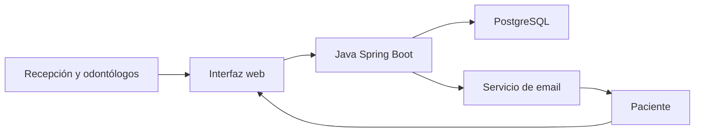

# Descripción general

## Stack tecnológico

Las tecnologías fueron elegidas explícitamente por el usuario. La investigación competitiva no obliga a adoptarlas ni determina sus versiones.

| Capa | Tecnología aprobada | Versión mínima |
| --- | --- | --- |
| Frontend | HTML, CSS y TypeScript vanilla | Pendiente; no se incorpora un framework de UI |
| Backend | Java 25 con Spring Boot 4.1.2 | Aprobados para C-02; Maven |
| Base de datos | PostgreSQL 18.7 | Compose para desarrollo y Testcontainers para pruebas |

Go, Node, OpenSpec, Active Stack y Engram pertenecen al entorno de trabajo preparado. Su instalación no decide el runtime, la herramienta de build o el despliegue del producto. Las versiones observadas del entorno no se convierten en versiones mínimas de la aplicación.

## Arquitectura general

La clasificación de trabajo es una aplicación web para un consultorio de una sede. El equipo gestiona la operación y el paciente accede a la cancelación por enlace y a la lista de espera desde su cuenta.

La vista lógica permite identificar responsabilidades sin fijar protocolo, carpetas ni bibliotecas adicionales:

La relación entre esas capas representa el stack elegido, no un contrato REST ni una topología de despliegue implementada. La organización del backend, el acceso a datos y la forma de servir el frontend están pendientes en [arquitectura propuesta](08_arquitectura_propuesta.md).

## Integraciones externas

| Servicio | Propósito en el MVP | Tipo de integración |
| --- | --- | --- |
| Email obligatorio | Email al crear con enlace de cancelación, recordatorio automático 24 horas antes y aviso automático de huecos | Servicio gratuito por definir. Envíos reales a direcciones de prueba indicadas por el equipo. |

Presupuesto externo cero. Google Calendar, WhatsApp Business API, Mercado Pago y ARCA quedan fuera de la integración requerida. C-02 usa PostgreSQL 18.7 dedicado mediante Compose y pruebas temporales Testcontainers; el despliegue productivo sigue pendiente.

## Interfaz entre frontend y backend

No se eligieron endpoints, métodos HTTP, formatos de error, DTO, identificadores ni versiones de API. Se conocen las operaciones de dominio que el contrato futuro tendrá que cubrir:

| Operación requerida | Comportamiento aprobado | Contrato técnico |
| --- | --- | --- |
| Gestionar pacientes/fichas | Ficha sencilla, separando lectura y edición clínica | Pendiente |
| Crear turno | Profesional y sillón disponibles; duración e intervalo | Pendiente |
| Reprogramar turno | Cambiar fecha/hora/recursos conservando prestación y duración | Pendiente |
| Cancelar turno | Cancelación interna; para el paciente, enlace hasta 48 horas antes. Liberación inmediata del horario. | Pendiente |
| Confirmaciones | Listado y registro manual por recepción | Pendiente |
| Consultar agenda de sillón y bloquear recursos | Vistas diaria y semanal. Recepción bloquea por períodos y se rechazan conflictos con turnos existentes. | Pendiente |
| Gestionar inscripción en lista de espera | Cuenta del paciente. Prestación, fechas, franjas horarias y profesional opcional. | Pendiente |
| Avisar de un hueco y asignarlo | Aviso automático; recepción confirma quién lo toma. | Pendiente |
| Enviar emails de turno | Email con enlace al crear y recordatorio 24 horas antes sin opción de cancelar cuando venció el plazo. | Pendiente |

El acceso por enlace y cuenta requiere un contrato por definir. El diseño técnico debe acordarse antes de implementar el change que lo necesite.

## Escala y condiciones de operación

Una sede con varios usuarios internos, cuentas de pacientes para lista de espera y cantidades de recursos aún no definidas. No se inventan tráfico, concurrencia esperada, objetivos de latencia ni capacidad de almacenamiento. Las solicitudes simultáneas son un riesgo a verificar, independientemente del tamaño final.

## Fuentes y pendientes

Consultar PA-05, PA-09 y PA-15 a PA-21. [Preguntas abiertas](10_preguntas_abiertas.md) · [Discovery](../docs/discovery/discovery.md) · [Decisiones aprobadas](../docs/discovery/decisiones-aprobadas.json) · [Ampliación aprobada, punto 8](../docs/discovery/ampliacion-paciente.md)
