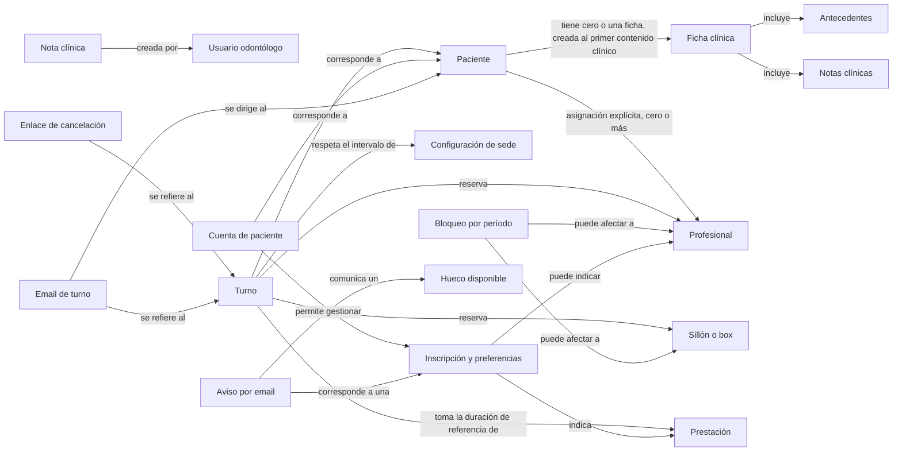

# Modelo de datos

## Dominios

- **Pacientes y ficha clínica.** Identificar al paciente en la operación del consultorio y conservar antecedentes y notas.
- **Agenda.** Registrar turnos por prestación y asignarlos a un profesional y un sillón o box de la sede.
- **Disponibilidad.** Representar bloqueos de sillones, profesionales o ambos por período.
- **Acceso y comunicaciones del paciente.** Relacionar cuentas con pacientes, enlaces con turnos y emails con sus destinatarios.
- **Lista de espera.** Registrar preferencias, relacionar huecos con avisos y representar la asignación que realiza recepción.
- **Equipo y configuración.** Distinguir al personal del consultorio y representar el intervalo común entre turnos.

## Relaciones conceptuales

El diagrama representa asociaciones del dominio. Su dirección expresa cómo se lee la asociación y las cardinalidades quedan abiertas, salvo la asignación obligatoria de un profesional y un sillón a cada turno.

## Entidades y conceptos

| Concepto | Información respaldada por el relevamiento | Límite o estado pendiente |
| --- | --- | --- |
| Paciente | UUID y `codigo` existentes; nombre, apellido y email obligatorios; teléfono opcional. El email no es único. Recepción y odontología pueden crear, consultar y editar datos administrativos dentro de su alcance. | Los demás alcances de pacientes y turnos fuera de C-04 siguen pendientes. |
| Asignación paciente-profesional | Un paciente puede estar asignado explícitamente a cero o más profesionales. Recepción asigna o quita profesionales; odontología no administra el vínculo. La asignación vigente delimita el acceso por registro. | C-04 no conserva historial de asignaciones ni concede eliminación del paciente. |
| Ficha clínica, antecedentes y notas | Cada paciente tiene cero o una ficha, creada al guardar los primeros antecedentes o la primera nota. Antecedentes son texto editable; las notas son entradas separadas con autor y fecha de creación. Solo el autor odontólogo asignado edita su nota. | No se habilita eliminación de ficha, antecedentes o notas. Otros dominios clínicos (como odontograma) están fuera del alcance. |
| Profesional y usuario interno | El profesional atiende turnos como recurso obligatorio. El usuario odontólogo se vincula a su referencia profesional según C-03/C-05. | Los demás alcances de permisos y modelos fuera de C-04 siguen abiertos (PA-05/07). |
| Sillón o box | Recurso físico obligatorio de la única sede. Su ocupación debe comprobarse en la agenda. | Cantidad, identificador, atributos y reglas de disponibilidad (PA-04, PA-07 y PA-08). |
| Prestación | Aporta la duración de referencia al crear un turno. Reprogramar conserva la prestación y la duración del turno. | Campos del catálogo, forma de administrarlo y relación con los turnos guardados (PA-07 y PA-14). |
| Turno | Fecha, hora, profesional, sillón o box, prestación y duración efectiva son datos de la reserva. La confirmación manual y la cancelación tienen efectos en el flujo de agenda. | Identificador, estados, transiciones y representación de las confirmaciones (PA-02 y PA-07). |
| Configuración de sede | Hay una única sede y un único intervalo configurable común. El valor inicial registrado en las fuentes es `null` (pendiente). | Minutos iniciales, límites, permisos y aplicación de cambios en la configuración (PA-01). |
| Bloqueo de recursos | Período y sillón, profesional o ambos. Se rechaza si afecta turnos existentes. | Límites de período, modificación o desbloqueo y permisos detallados (PA-04 y PA-19). |
| Cuenta de paciente | Se usa para gestionar la inscripción propia. | Registro, verificación, vínculo con paciente y alcance (PA-16). |
| Enlace de cancelación | Se refiere a un turno y se envía en el email de alta. La cancelación tiene un plazo de hasta 48 horas antes. | Vigencia, protección, reutilización y efecto de los cambios del turno (PA-17 y PA-18). |
| Email de turno | Destinatario y turno asociado para el email de alta y el recordatorio. | Verificación de destinatarios, proveedor, programación, registro de entrega y duplicados (PA-15 y PA-18). |
| Inscripción en lista de espera | Prestación, rango de fechas y franjas horarias, con profesional opcional. | Ciclo de la inscripción y criterios exactos para vincularla con huecos (PA-16 y PA-20). |
| Hueco y aviso | El aviso comunica un hueco liberado a interesados; recepción confirma quién toma el hueco y realiza la asignación. | Representación del hueco, relación con preferencias y turnos, y manejo de huecos ocupados (PA-20 y PA-21). |

## Reglas que condicionan el modelo

- Un alta o reprogramación debe validar la disponibilidad del profesional y del sillón o box, incluidos sus bloqueos, además del intervalo de la sede.
- La duración efectiva debe estar disponible al reprogramar, incluso si se ajustó en el alta. Cómo representarla en persistencia queda abierto.
- La cancelación libera el horario de inmediato. Qué estado y qué representación se emplean queda abierto.
- Para pacientes y ficha, C-04 define UUID/código existentes, relación muchos-a-muchos paciente-profesional, ficha opcional uno-a-uno y notas uno-a-muchos. El esquema físico de los demás dominios, sus restricciones e índices siguen abiertos (PA-07).

## Datos iniciales

La sede única forma parte del alcance aprobado. La cantidad de profesionales y sillones, las prestaciones iniciales y los minutos del intervalo siguen pendientes (PA-01, PA-08 y PA-14). Los ejemplos, pruebas y capturas utilizan pacientes ficticios. Para demostrar el envío real de emails se usarán las direcciones de prueba indicadas por el equipo.

Fuentes y referencias. [Ampliación aprobada](../docs/discovery/ampliacion-paciente.md) · [Discovery, secciones 2, 3, 5, 7 y 9](../docs/discovery/discovery.md) · [Decisiones aprobadas](../docs/discovery/decisiones-aprobadas.json) · [Reglas de negocio](05_reglas_de_negocio.md) · [Preguntas abiertas](10_preguntas_abiertas.md)
